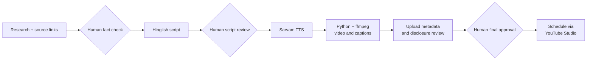

# CreatorOS

**An AI-assisted workflow for producing content across multiple YouTube brands — with a working Shorts pilot and a web platform still in development.**

CreatorOS started with a question: can one person operate several distinct content brands using AI without losing control over quality, facts and publishing decisions?

I'm testing that with three faceless Hinglish YouTube channels. The first Short was published on **25 October 2026**.

This is an early pilot, not a validated business. I don't have meaningful audience traction, reliable time-savings measurements or proven unit economics yet.

**Important distinction:** The live Shorts were produced using private Python scripts. This public repository contains the web application foundation, but it does not yet reproduce the complete publishing workflow.

## What has shipped

**[Watch the first published Short](https://youtube.com/shorts/1r2bb3emRn8)**

Three pilot brands:

| Channel | Content |
|---|---|
| **AI Ka Wala** ([@aikawala](https://youtube.com/@aikawala)) | AI tools, technology and news in Hinglish |
| **Parallel Kya** ([@parallelkya](https://youtube.com/@parallelkya)) | Original what-if fiction and evidence-based examinations of conspiracy theories |
| **Startup Khulasa** ([@startupkhulasa](https://youtube.com/@startupkhulasa)) | Indian startups, business models and operating economics |

The pilot uses a workflow covering research, scripts, voiceovers, video rendering, metadata preparation and scheduled publishing.

Initial Shorts have gone live, with further content scheduled through YouTube Studio.

Publishing still requires human review and manual coordination. This is not a fully autonomous system.

## What exists in this repository

| Component | Location | Current state |
|---|---|---|
| Web application | `frontend/` | Login, brand wizard, AI chat, script writer and video-project workspaces |
| AI services | `frontend/services/ai/` | Multi-provider routing, brand context and prompt-building services |
| Agent definitions | `frontend/services/ai/agents/` | Research, scripting, SEO and other agent definitions; orchestration remains early-stage |
| Data and storage | `supabase/migrations/` | Database schema and supporting migrations |
| Audio/video services | `frontend/services/audio/`, `frontend/services/video/` | Generation records, storage-related logic and provider interfaces; video generation currently uses a mock provider |
| Application tests | `frontend/` | Tests covering video duration contracts, asset policies and storage cleanup |

**Stack:** Next.js, TypeScript, Supabase, OpenAI, Anthropic and Gemini integrations.

The repository demonstrates application architecture and implemented components, not a complete deploy-and-publish product.

### What runs separately

The working Shorts-production scripts are private and currently use Python, Sarvam TTS and ffmpeg.

They have not yet been integrated into the public app's production-service layer.

## Current pilot workflow

The diagram below describes the workflow used for producing Shorts with private scripts and manual review. It is **not** a diagram of fully implemented orchestration in this repository.

An additional LLM review examines proposed titles, hooks and metadata. I review its suggestions and record reasons for rejected changes.

For factual content, the publishing checklist includes source verification. AI voice disclosures and synthetic-content settings are reviewed where applicable.

The goal is to use AI to reduce repetitive work without giving it unchecked publishing authority.

## What worked

**1. Getting real output published**

The private workflow produced Shorts using scripted narration, AI voiceovers, vertical renders, captions and upload metadata.

Publishing is the first operational milestone. It does not establish reliability at scale or audience demand.

**2. Human review catching problems**

The review process has caught wording and title suggestions that needed revision before publication.

A second model can flag issues, but the final judgment remains human.

**3. Shared brand rules**

The workflow uses separate brand identities and voice guidelines so that technology explainers, fictional stories and business breakdowns do not default to the same presentation.

Whether these differences improve audience response remains untested.

## What didn't work

**Instagram rollout**

Two brand accounts were disabled, and a replacement account was also disabled after an identity check.

I haven't established the cause. Rather than repeatedly creating accounts, I paused the Instagram rollout and focused the pilot on YouTube.

**Overly formal Hinglish**

Early scripts used literal Hindi translations that sounded unnatural during review.

For example, using formal Hindi where the audience would normally say "zero."

I adjusted the writing guidelines toward everyday spoken Hinglish.

**Voice iteration**

Earlier prototypes used Edge TTS. The pilot moved to Sarvam bulbul:v3, but voice pacing, pronunciation and delivery still need refinement.

**Incomplete integration**

The public app and the working private production scripts remain separate. The web application's mock video provider is not a real rendering integration.

Analytics ingestion and automated performance feedback are also unfinished.

## What I'm building next

The immediate priority is to make the workflow measurable and reproducible before adding more autonomy.

1. **Unify the workflow:** Bring the private rendering steps into the app's provider architecture, with explicit approval states and versioned content records.

2. **Measure operating costs and failures:** Track production time, human review effort, model/API costs, publishing failures and cost per finished video.

3. **Learn from actual performance:** Start with manual YouTube Studio analytics snapshots, compare results by brand and experiment, and decide what deserves further investment.

The initial 30-day pilot has an incremental spending cap of **₹5,000**.

The decision isn't simply whether AI can generate videos. It can.

The question is whether this workflow can produce accurate, engaging content **reliably, with manageable human effort and sustainable costs**.

If the evidence doesn't support continuing, I'll change the approach or stop the experiment rather than automate something that isn't working.

---

**Built by Shashank Dhariwal · Gurugram, India**

*Current status: early working pilot. Public app integration, analytics and repeatable operating economics are not yet established.*
